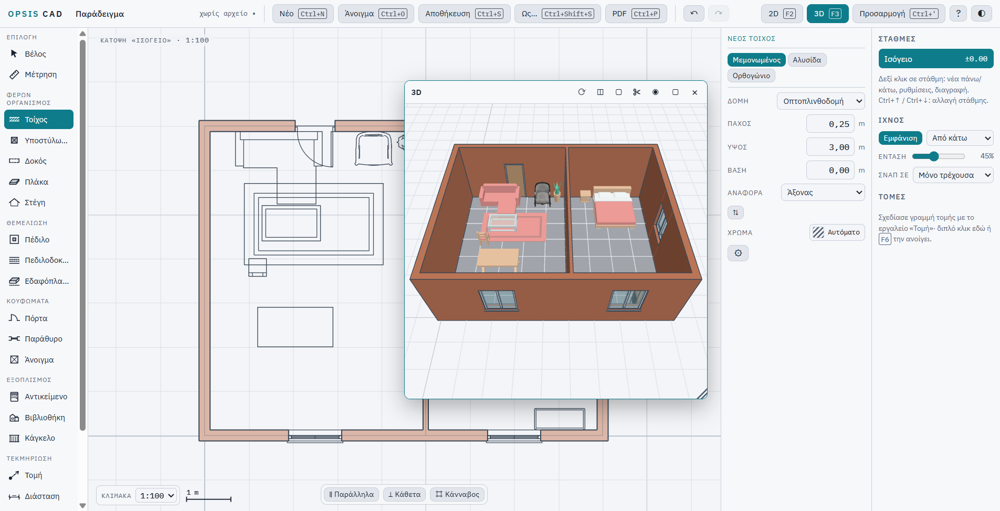
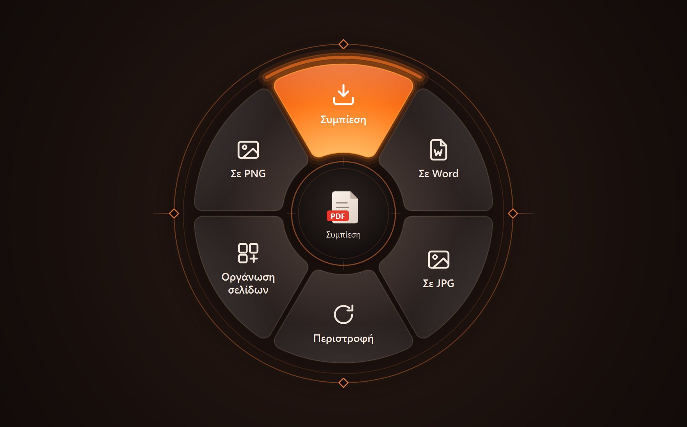
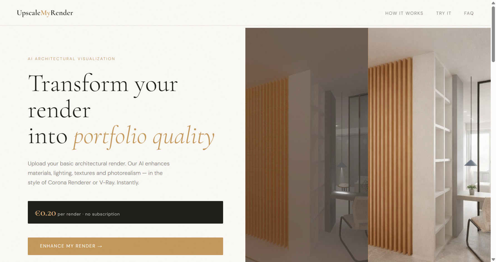
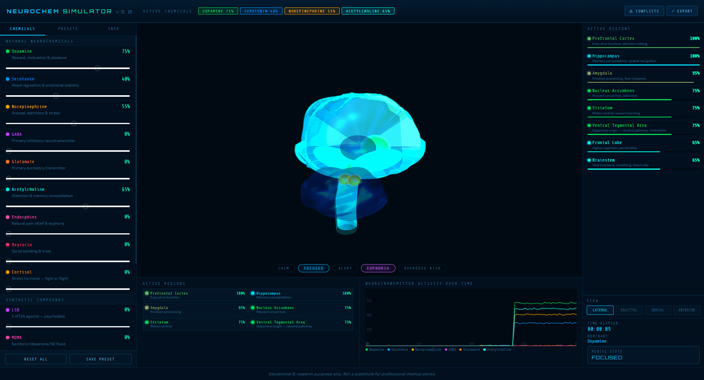

# Haralampos Moutidis

Civil engineer, building software for architecture and engineering. I design the tools I need as an
engineer who works daily in ArchiCAD and AutoCAD, and build them together with AI coding agents
(Claude Code): specifications first, then code with automated tests.

## Projects

### KATOPSIS CAD (formerly OPSIS CAD): BIM where the plan and the 3D are one model
*Private repository; demo on request. Current version 0.5.0.*

A desktop BIM/CAD application for architectural and structural design, inspired by how ArchiCAD is
used (clean-room, no code of other programs).

- Walls (straight and curved, fillet) with automatic joins, columns, beams, slabs, foundations, roofs (hip and
  polygonal roofs from a straight skeleton), doors and windows that cut their walls, railings, furniture and a
  library of 3D objects
- Free-form solids (Morph) and site terrain from contour lines (constrained Delaunay)
- Survey from a photo of a hand sketch: Claude reads the dimensions, a solver closes the plan and reports
  what does not add up, then walls, openings and the floor area are built
- Associative dimensions, sections and elevations without hidden lines, sun and shadows, hatches, text,
  stories, undo/redo
- PDF at any scale with title block and marquee printing; PDF and DWG underlays; IFC import/export; 3D export
  to glTF and OBJ (Blender, Twinmotion, Artlantis)
- TypeScript, three.js, Electron; Windows installer; 500+ automated tests

### QuickWheel: a game-style tool wheel for files in Windows Explorer
*Private repository.*

Hold the right mouse button on a file and a radial menu opens; flick toward a tool and release. The tools
follow the selection: compress a PDF, convert it to Word / JPG / PNG, merge PDFs, images and Office files in a
window where pages are dragged into order and rotated, remove the background of a photo (IS-Net, offline),
convert HEIC / JPG / PNG, Office to PDF. Python, PySide6, PyMuPDF, ONNX Runtime; one-click Windows installer.

### [UpscaleMyRender](https://github.com/haralamposmoutidis-source/UpscaleMyRender): AI enhancement of architectural renders
Upload a basic render and get a photorealistic, portfolio-quality version (Corona / V-Ray look) while the
architecture stays exactly as designed. **[Live page](https://haralamposmoutidis-source.github.io/UpscaleMyRender/)**

### [Neurochem Simulator](https://github.com/haralamposmoutidis-source/brain): real-time brain chemistry in 3D
Set neurochemical and substance levels and watch the affected brain regions, the mental state and the
activity over time on an interactive 3D brain. **[Live demo](https://haralamposmoutidis-source.github.io/brain/)**

## Tools
TypeScript · JavaScript · Python · three.js · Electron · PySide6 · Vite · Vitest · ONNX Runtime · OpenAI API ·
ArchiCAD · AutoCAD
