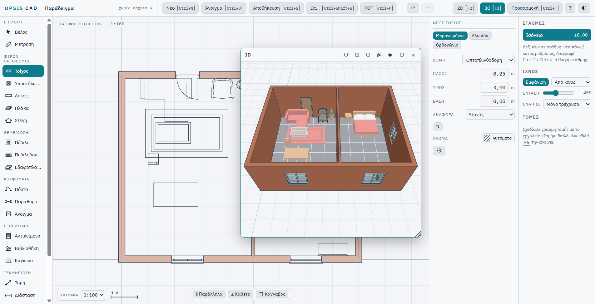
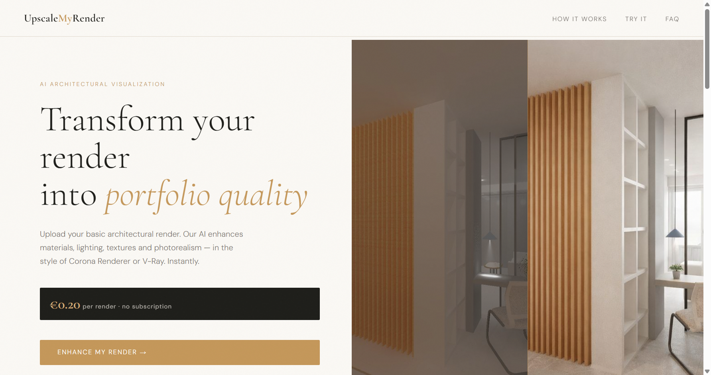

# Haralampos Moutidis

Civil engineer, building software for architecture and engineering. I design the tools I need as an
engineer who works daily in ArchiCAD and AutoCAD, and build them together with AI coding agents
(Claude Code): specifications first, then code with automated tests.

## Projects

### OPSIS CAD: BIM where the plan and the 3D are one model
*Private repository; demo on request.*

A desktop BIM/CAD application for architectural and structural design, inspired by how ArchiCAD is
used (clean-room, no code of other programs).

- Walls with automatic joins, columns, beams, slabs, foundations, roofs (hip and polygonal roofs from a
  straight skeleton), doors and windows that cut their walls, railings, furniture and a library of 3D objects
- Associative dimensions, sections and elevations, hatches, text, stories, undo/redo
- PDF at 1:50 / 1:100; export of the 3D model to glTF and OBJ (Blender, Twinmotion, Artlantis)
- TypeScript, three.js, Electron; Windows installer; 300+ automated tests

### [UpscaleMyRender](https://github.com/haralamposmoutidis-source/UpscaleMyRender): AI enhancement of architectural renders
Upload a basic render and get a photorealistic, portfolio-quality version (Corona / V-Ray look) while the
architecture stays exactly as designed. **[Live page](https://haralamposmoutidis-source.github.io/UpscaleMyRender/)**

### [Neurochem Simulator](https://github.com/haralamposmoutidis-source/brain): real-time brain chemistry in 3D
Set neurochemical and substance levels and watch the affected brain regions, the mental state and the
activity over time on an interactive 3D brain. **[Live demo](https://haralamposmoutidis-source.github.io/brain/)**

## Tools
TypeScript · JavaScript · three.js · Electron · Vite · Vitest · OpenAI API · ArchiCAD · AutoCAD
